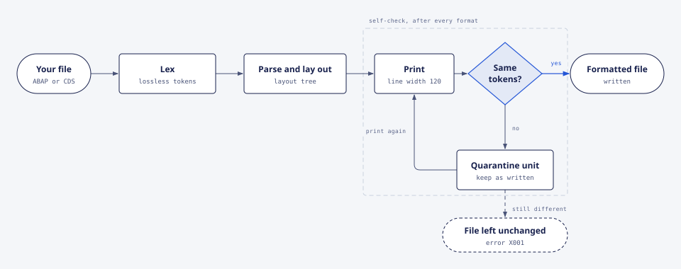
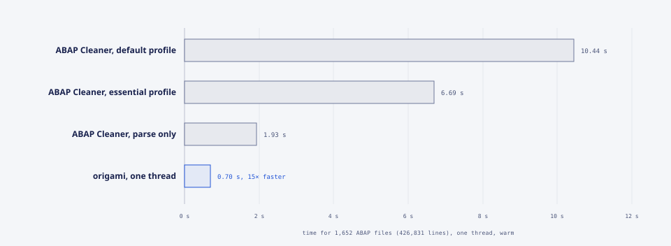

<div align="center">

<picture>
  <source media="(prefers-color-scheme: dark)" srcset="docs/assets/logo-dark.svg">
  
</picture>

# origami

**A long line of ABAP, folded into shape.**<br>
A formatter for ABAP and CDS that changes layout and nothing else, checks its own output token by token, and tells you why it broke each line.

[](https://github.com/nimble-123/origami/releases)
[](https://github.com/nimble-123/origami/actions/workflows/ci.yml)
[](#license)
[](https://www.rust-lang.org)
[](#supported-files)
[](#install)

[Website](https://nimble-123.github.io/origami/) · [Playground](https://nimble-123.github.io/origami/#playground) · [Why origami](#why-origami) · [Install](#install) · [Use](#use) · [How it works](#how-it-works) · [Documentation](#documentation) · [License](#license)

</div>

> [!NOTE]
> origami is pre-release (0.1). All six languages are formatted by grammar,
> every file of a 2,100-file test corpus passes the self-check and is
> idempotent at 80 combinations of line width, indent and keyword case, and
> the abaplint lexer finds no token changes. From the next release, origami
> is also published to crates.io and the VS Code Marketplace. Still open:
> signed builds (they wait for signing certificates), Open VSX, and feedback
> from teams using it daily. Please [open an issue](https://github.com/nimble-123/origami/issues)
> with any line origami formats in a way you would not.

<div align="center">

<picture>
  <source media="(prefers-color-scheme: dark)" srcset="docs/assets/review-demo-dark.svg">
  
</picture>

</div>

## Why origami

- **Layout only.** Whitespace, line breaks, indentation and letter case in ABAP: keywords in upper case, identifiers without a lower-case letter in lower case, as ABAP Cleaner does. origami never renames, reorders or rewrites a statement, so a formatted diff is easy to review.
- **Checked, every time.** After formatting, origami lexes its own output and compares every token and comment with your file. If anything but layout differs, that statement is left as written. A file with a structural error is never touched, and very deep nesting (over 100 levels) or a file over 8 MB is left as written too (W004), so time and memory stay bounded.
- **Explained.** `origami --review` shows the changes before anything is written, with a note on every line break origami adds: which rule, and at which column the line would have ended.
- **Fast.** A median file takes 0.07 ms in process and 1.8 ms as a new process, start-up included; 99 % of files take under 4 ms. The whole 2,100-file test corpus takes 0.2 s. Fast enough for format-on-save, pre-commit hooks and agents ([benchmark](docs/benchmark.md)).
- **Fits how SAP teams work.** abapGit repositories, ADT for VS Code documents, `--changed` for brownfield code, a GitHub Action, and an MCP server for AI agents.

## Features

| | |
| --- | --- |
| **ABAP** | Classes, interfaces, RAP handlers, EML, ABAP SQL (CTEs, subqueries, database DML), constructor expressions, reports, selection screens, event blocks, `FORM` routines, function modules, dynpro flow logic. Up to SAP_BASIS 8.16. |
| **CDS family** | Data definitions (DDLS), metadata extensions (DDLX), access controls (DCL), behavior definitions (BDEF), service definitions (SRVD): annotations, headers, `case` expressions, grants. |
| **Review** | `--review` prints changes with old and new line numbers, the changed characters highlighted and a note per broken construct. `--check --diff` stays a plain unified diff for scripts. |
| **Partial formatting** | `--changed [REF]` formats only the lines you touched; `--lines 40:75` only those lines. In VS Code: *Format Selection* and format-on-save for modified lines. |
| **VS Code** | Formatter for files and ADT documents, problems in the Problems panel, *origami: Preview Changes* in the diff view with *Apply*. |
| **CI** | GitHub Action with code-scanning annotations (SARIF), templates for GitLab and Azure Pipelines, pre-commit hooks. |
| **AI agents** | `origami --mcp` (tools `format` and `format_files`), and a compact agent output with a next step. |
| **Configuration** | `origami.toml`: line width, indentation, keyword case, required version. Nothing else to tune: the style is written down rule by rule in [STYLE.md](docs/STYLE.md). |

## Install

```sh
brew install nimble-123/tap/origami        # macOS and Linux
cargo install abap-origami                 # crates.io, from the next release
```

Release binaries for macOS, Linux and Windows, each with a `.sha256` file, and
the VS Code extension (`.vsix`) are on the
[releases page](https://github.com/nimble-123/origami/releases).

Try it without installing: the [playground](https://nimble-123.github.io/origami/#playground)
runs origami in your browser (WebAssembly, nothing is uploaded).

## Use

```sh
origami                        # format all ABAP and CDS files below .
origami --review               # show what would change, and why lines break
origami --check                # CI: exit 1 if anything would change
origami --changed main         # only lines changed against main (+ new files)
origami --lines 40:75 zcl_foo.clas.abap
cat zcl_foo.clas.abap | origami --stdin-filepath zcl_foo.clas.abap
```

Configuration, found by walking up to the repository root:

```toml
# origami.toml
required_version = ">=0.1, <0.2"
line_width = 120
indent_width = 2

[abap]
keyword_case = "upper"
```

Flags, exit codes, diagnostic codes and the JSON schema: [docs/CLI.md](docs/CLI.md).

<details>
<summary><strong>VS Code</strong></summary>

Install the `.vsix` from the release, then make origami the formatter:

```json
"[abap]": { "editor.defaultFormatter": "nimble-123.abap-origami" },
"[acds]": { "editor.defaultFormatter": "nimble-123.abap-origami" },
"editor.formatOnSave": true,
"editor.formatOnSaveMode": "modifications"
```

*origami: Preview Changes* shows the formatting of the open file in the diff
view; *Apply* writes it into the document (unsaved). Details:
[editors/vscode/README.md](editors/vscode/README.md).

</details>

<!-- x-release-please-start-version -->
<details>
<summary><strong>CI and pre-commit</strong></summary>

```yaml
# .github/workflows/origami.yml
on: [pull_request]
permissions: { contents: read, security-events: write }
jobs:
  format:
    runs-on: ubuntu-latest
    steps:
      - uses: actions/checkout@v4
        with: { fetch-depth: 0 }
      - uses: nimble-123/origami@v0.2.1
        with:
          args: --check --changed origin/${{ github.base_ref }}
          sarif: "true"
```

```yaml
# .pre-commit-config.yaml
repos:
  - repo: https://github.com/nimble-123/origami
    rev: v0.2.1
    hooks:
      - id: origami        # check only
      # - id: origami-fix  # rewrite files
```

GitLab CI and Azure Pipelines: [docs/ci.md](docs/ci.md). Rolling origami out
in a team: [docs/adoption.md](docs/adoption.md).

</details>
<!-- x-release-please-end -->

<details>
<summary><strong>AI agents</strong></summary>

```sh
claude mcp add origami -- origami --mcp
```

The MCP server offers `format` (source text in, formatted text and
diagnostics out) and `format_files` (check or rewrite files below the working
directory, optionally only changed lines). Without MCP, pipe source through
stdin: on any error stdout stays empty, so an agent never writes an empty
object back. When `CLAUDECODE` is set, diagnostics come in a compact agent
format that ends with a `NEXT:` line.

</details>

## How it works

<div align="center">
  <picture>
    <source media="(prefers-color-scheme: dark)" srcset="docs/assets/pipeline-dark.svg">
    
  </picture>
</div>

- **Lossless lexer.** Every byte of the input is a token or trivia (space, line break, comment), so the output can be compared with the input exactly.
- **Grammar, then layout.** Each statement is parsed and turned into a layout tree: groups that print flat when they fit and break by fixed rules when they do not, hanging indentation, aligned `=` in parameter lists.
- **Self-check and quarantine.** A statement whose output tokens differ from its input tokens is printed as written (W001); a line over ABAP's 255-character limit is avoided the same way (W002).
- **Line-break notes.** The final layout is printed a second time without a width limit. A break that disappears there was caused by the width, one that stays by a rule or a comment; the rule that laid out the construct gives the note its ID.

<div align="center">
  <picture>
    <source media="(prefers-color-scheme: dark)" srcset="docs/assets/benchmark-dark.svg">
    
  </picture>
</div>

ABAP Cleaner applies about 100 cleanup rules, several of which change code;
origami only changes layout. The numbers compare the time to process the same
files, not the same work. Per-file latencies (p50, p95, p99), cold and warm starts, MCP, WebAssembly and thread scaling: [docs/benchmark.md](docs/benchmark.md).
The layout itself, the same code formatted by ABAP Cleaner's layout rules and
by origami, and every ABAP Cleaner rule next to origami's:
[origami and ABAP Cleaner](https://nimble-123.github.io/origami/abap-cleaner.html).

## Supported files

| abapGit file | Language |
|---|---|
| `*.clas.abap` (incl. `locals_def`, `locals_imp`, `testclasses`, `macros`), `*.intf.abap` | ABAP |
| `*.prog.abap`, `*.fugr.*.abap`, `*.type.abap` | ABAP (reports, selection screens, event blocks, `FORM` routines, function modules) |
| `*.screen_<nr>.abap` | dynpro flow logic |
| `*.ddls.asddls`, `*.drty.acds` | CDS data definitions |
| `*.ddlx.asddlxs` | metadata extensions |
| `*.dcls.asdcls` | access controls |
| `*.bdef.asbdef` | behavior definitions |
| `*.srvd.srvdsrv` | service definitions |

## Documentation

- [Style](docs/STYLE.md): every output rule, with examples and line-break explanations
- [Invariants](docs/INVARIANTS.md): what "layout only" means and how it is checked
- [Command line](docs/CLI.md): flags, exit codes, diagnostics, configuration
- [CI](docs/ci.md) and [adopting origami in a team](docs/adoption.md)
- [Releasing](docs/releasing.md): how a release is built, signed and published, and how to verify a download
- [Security policy](SECURITY.md) and [contributing](CONTRIBUTING.md)
- [Performance](docs/benchmark.md): per-file latencies, cold and warm starts, agents, threads, ABAP Cleaner
- [origami and ABAP Cleaner](https://nimble-123.github.io/origami/abap-cleaner.html): the same code formatted by both, and every ABAP Cleaner rule next to origami's ([how it is built](scripts/abap-cleaner-compare/README.md))
- [Design](docs/designs/origami.md) and [line-break explanations](docs/designs/origami-explain-review.md)
- [Visual design](docs/brand.md)

## Development

```sh
cargo xtask corpus fetch                             # once: the real-world corpus
cargo xtask ci                                       # the whole pre-PR chain, stops at the first failure
cargo xtask ci --full                                # also: idempotency at 80 settings (minutes)
cargo +nightly fuzz run format_abap                  # fuzzing (also format_cds, format_lines, explain)
sh site/build.sh && python3 -m http.server -d site/dist   # website
```

`cargo xtask ci` runs fmt, clippy, the tests, the corpus, the line-break
notes, the abaplint cross-check and the mutation stress test; each step is
also its own command (see [CONTRIBUTING.md](CONTRIBUTING.md)).

Contributions start with an issue. A change to the output needs a rule in
[STYLE.md](docs/STYLE.md) first; see "How rules work" there.

## License

Licensed under either of [Apache License 2.0](LICENSE-APACHE) or
[MIT](LICENSE-MIT), at your option.
