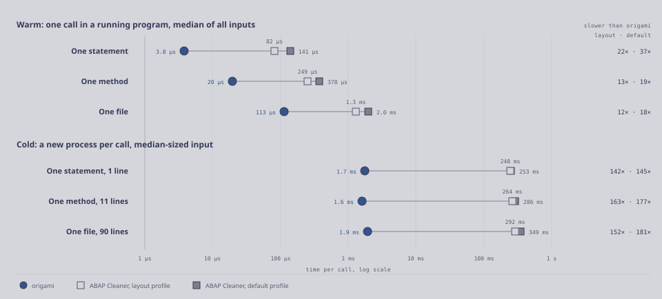
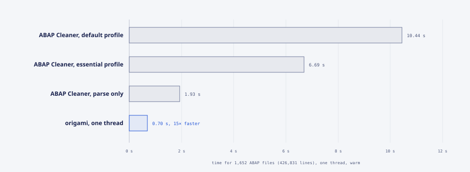

# Performance: origami vs ABAP Cleaner

> This page compares origami with ABAP Cleaner, cold and warm, for one
> statement, one method, one file and the whole project (generated by
> `cargo xtask bench-compare`), keeps the first comparison of 2026-11-21 and
> explains how ABAP Cleaner is run. origami's other measurements (MCP,
> WebAssembly, thread scaling, output formats) are in
> [benchmark.md](benchmark.md). The layout of both tools side by side, and
> every ABAP Cleaner rule next to origami's rules, is on the
> [comparison page](https://nimble-123.github.io/origami/abap-cleaner.html).

## The two tools do different work

ABAP Cleaner applies about 100 cleanup rules, several of which change code
(for example `NEW` instead of `CREATE OBJECT`). origami only changes layout.
The numbers below compare the time to process the same files, not the same
work.

The current measurement therefore runs ABAP Cleaner with two profiles: its
default profile, as most people use it, and the layout profile, the default
profile reduced to the rules that only change whitespace, line breaks and
letter case (`Compare.layoutProfile()` in
[Compare.java](../scripts/abap-cleaner-compare/Compare.java), described in
[its README](../scripts/abap-cleaner-compare/README.md)). The layout profile
is the closer comparison; it still does not produce origami's layout. In the
first measurement, the "parse only" row was the closest comparison: ABAP
Cleaner parses and checks the code without applying rules.

## How ABAP Cleaner is run

The native launcher of the macOS download has an invalid code signature, so
macOS Gatekeeper rejects it. ABAP Cleaner is therefore run through its Java
API (`Job.createForSingleCodeDocument`, profiles `Profile.createDefault()`,
`Profile.createEssential()` and the layout profile) with the harness in
`scripts/abap-cleaner-bench/Bench.java`, on the plugin jars of the release.
This skips the Eclipse/OSGi start of the real launcher, so the cold-start
number for ABAP Cleaner is a lower bound. The harness runs on one thread.
It is compiled together with `Compare.java`, which holds the layout profile,
so both scripts use one definition of it. In the current measurement the JVM
runs with its default garbage collector and a heap limit of 1 GB (per input
and cold runs) or 2 GB (whole project), to keep the measurement within the
memory of the machine.

<picture>
  <source media="(prefers-color-scheme: dark)" srcset="assets/granularity-dark.svg">
  
</picture>

<picture>
  <source media="(prefers-color-scheme: dark)" srcset="assets/benchmark-dark.svg">
  
</picture>

<!-- bench-compare:start -->
<!-- Generated by `cargo xtask bench-compare` from docs/benchmark-compare-data.json; do not edit by hand. -->

## Current measurement (2026-11-23)

Apple M4, 10 cores, 16 GB RAM, macOS 27.2.1, OpenJDK Runtime Environment Temurin-27.0.1.1+4 (build 27.0.1.1+4), ABAP Cleaner 1.29.2, origami at commit `7ee2048`. JVM: -Xmx1g per input and cold, -Xmx2g for the project; default garbage collector. All times in milliseconds unless marked.

### Inputs

All taken from the ABAP files of the test corpus. Methods and statements are cut out of the class files as written (see `xtask/src/bench_compare.rs`) and saved as separate files, so both tools read the same bytes.

| Granularity | Inputs | Median lines | p95 lines | Max lines | Lines of the median input (cold runs) |
|---|---:|---:|---:|---:|---:|
| One statement | 481 | 1 | 5 | 12 | 1 |
| One method | 486 | 11 | 89 | 912 | 11 |
| One file | 1920 | 90 | 897 | 6837 | 90 |
| Whole project | 1920 files, 467586 lines | – | – | – | – |

### Warm: one call in a running process

As in an editor or a server that stays open. origami: the library function `format`, median of 3 runs per input. ABAP Cleaner: one JVM, 3 passes over all inputs, the times of the third pass (after the JIT compiler has warmed up). Per input, in **microseconds** (1,000 µs = 1 ms); the last column is the median divided by origami's median.

| Granularity | Tool | p50 | p95 | p99 | max | p50 vs origami |
|---|---|---:|---:|---:|---:|---:|
| One statement | origami | 3.79 | 12.5 | 23.5 | 87.2 | – |
| One statement | ABAP Cleaner, layout profile | 82.0 | 300 | 624 | 1575 | 22× |
| One statement | ABAP Cleaner, default profile | 141 | 429 | 812 | 1167 | 37× |
| One method | origami | 19.7 | 159 | 268 | 1532 | – |
| One method | ABAP Cleaner, layout profile | 249 | 1941 | 3928 | 20895 | 13× |
| One method | ABAP Cleaner, default profile | 378 | 3069 | 5283 | 35346 | 19× |
| One file | origami | 113 | 1344 | 5018 | 70946 | – |
| One file | ABAP Cleaner, layout profile | 1305 | 14416 | 41638 | 134276 | 12× |
| One file | ABAP Cleaner, default profile | 1993 | 21972 | 60234 | 216248 | 18× |

Inputs a tool reported an error on (it then leaves the input unchanged; the time still counts): statements (0 origami, 0 layout, 0 default), methods (0 origami, 0 layout, 0 default), files (0 origami, 29 layout, 29 default). All of ABAP Cleaner's errors are on screen files (`*.screen_NNNN.abap`), which hold dynpro flow logic rather than ABAP statements.

### Cold: a new process per call

As in a pre-commit hook, a format-on-save without a running server, or an agent calling a command: the median-sized input of each granularity, a new process per call. origami: the CLI, `--no-config --check`, 20 runs after 2 warm-up runs. ABAP Cleaner: a new JVM per call through the harness, 8 runs after 1 warm-up run. Peak memory from one more run.

| Granularity | Tool | median (ms) | max (ms) | median vs origami | peak memory (MB) |
|---|---|---:|---:|---:|---:|
| One statement (1 line) | origami | 1.74 | 2.12 | – | 3 |
| One statement (1 line) | ABAP Cleaner, layout profile | 248 | 277 | 142× | 116 |
| One statement (1 line) | ABAP Cleaner, default profile | 253 | 272 | 145× | 128 |
| One method (11 lines) | origami | 1.61 | 1.78 | – | 4 |
| One method (11 lines) | ABAP Cleaner, layout profile | 264 | 294 | 163× | 116 |
| One method (11 lines) | ABAP Cleaner, default profile | 286 | 310 | 177× | 144 |
| One file (90 lines) | origami | 1.93 | 1.99 | – | 4 |
| One file (90 lines) | ABAP Cleaner, layout profile | 292 | 312 | 152× | 156 |
| One file (90 lines) | ABAP Cleaner, default profile | 349 | 383 | 181× | 178 |

### Whole project

All 1920 ABAP files in one run. origami: the CLI with `--no-config --check` and the file paths; cold is the first run, warm the median of the 5 runs after it. ABAP Cleaner: one JVM over the same files, one thread; cold is the first pass including the JVM start (wall clock), warm the third pass. The operating system's file cache is warm for both, since the inputs were read before.

| Tool | cold | warm | warm vs origami `-j 1` | peak memory (MB) |
|---|---:|---:|---:|---:|
| origami, 1 thread (`-j 1`) | 0.95 s | 0.94 s | – | 33 |
| origami, one thread per core (10) | 0.18 s | 0.20 s | – | 62 |
| ABAP Cleaner, layout profile (`-Xmx2g`) | 9.08 s | 7.56 s | 8.0× | 693 |
| ABAP Cleaner, default profile (`-Xmx2g`) | 12.94 s | 11.49 s | 12× | 691 |

### How to read this

* **Cold** is what a single command costs: starting the program, reading the input, formatting it once. A JVM needs a few hundred milliseconds to start and load ABAP Cleaner before it formats anything, so for one statement or one method the cold time is almost all start-up. origami is a native program and starts in about a millisecond.
* **Warm** is what a call costs once the program is running and, for Java, the JIT compiler has compiled the hot code, as in an editor plug-in or a server. This compares the formatting work itself.
* **Whole project** is one command over many files, as in CI or a pre-commit run over a repository. Here the start-up is paid once; ABAP Cleaner's harness runs on one thread, so the fairest comparison is origami with `-j 1`.
* **The tools do different work.** The default profile of ABAP Cleaner applies about 100 rules, several of which change code, so it does more than origami. The layout profile (the default profile reduced to its layout rules, `Compare.layoutProfile()` in `scripts/abap-cleaner-compare/Compare.java`) only changes whitespace, line breaks and letter case, as origami does; it is the closer comparison. Neither profile produces the same layout as origami.
* ABAP Cleaner is run through its Java API, without the Eclipse start of its launcher, so its cold times are a lower bound.

<!-- bench-compare:end -->

## First measurement (2026-11-21)

Apple M4 (10 cores), macOS, Temurin JDK 27.0.1, ABAP Cleaner 1.29.2 (GitHub
release), origami at commit `ae9dc0f`. Input: all 1,652 `.abap` files of the
test corpus at that time (`corpus/manifest.toml`), 426,831 lines. ABAP
Cleaner processed all of them without errors.

Whole corpus, warm (third of three passes; ABAP Cleaner after JIT warm-up):

| Tool | Time | Per file | origami is faster by |
|---|---:|---:|---:|
| ABAP Cleaner, default profile | 10.44 s | 6.3 ms | 15× |
| ABAP Cleaner, essential profile | 6.69 s | 4.0 ms | 9.6× |
| ABAP Cleaner, parse only | 1.93 s | 1.2 ms | 2.8× |
| origami, 1 thread (CLI, `--check`, incl. file reading) | 0.70 s | 0.42 ms | – |
| origami, 10 threads (CLI, `--check`) | 0.19 s | – | 55× vs default |

origami numbers re-measured on 2026-11-21 after the classic-ABAP and 8.16
grammar (first measurement at `3e595ca`: 0.62 s and 0.14 s).

One file, cold (a new process per call, as in a pre-commit hook or a
format-on-save without a running server), median-sized class (81 lines):

| Tool | Time |
|---|---:|
| ABAP Cleaner (JVM start + one file, default profile) | 356 ms |
| origami | 1.8 ms |

ABAP Cleaner 1.29 also has a daemon mode that keeps the JVM running; with
it, a call costs about the warm per-file time above (4–6 ms) plus the
request round trip.

## Reproduce

The current measurement (writes docs/benchmark-compare-data.json and the
section above; about 5 minutes, needs 3 GB of free memory):

```sh
cargo xtask corpus fetch
cargo build --release -p abap-origami -p xtask
ABAP_CLEANER_PLUGINS=…/abapcleaner.app/Contents/Eclipse/plugins \
  target/release/xtask bench-compare
target/release/xtask bench-compare --report   # only rewrite the section from the data
```

The first measurement, by hand:

```sh
# ABAP Cleaner release, unpacked; P = .../abapcleaner.app/Contents/Eclipse/plugins
find corpus/repos -path '*/.git' -prune -o -type f -name '*.abap' -print \
  | LC_ALL=C sort | sed "s#^#$PWD/#" > /tmp/abap-files.txt
cd scripts
javac -cp "$P/*" -d /tmp/acb abap-cleaner-bench/Bench.java abap-cleaner-compare/Compare.java
java -Xmx4g -cp "/tmp/acb:$P/*" Bench default /tmp/abap-files.txt 3   # also: essential, layout, parse

# origami: copy the same files into one folder, then
RAYON_NUM_THREADS=1 target/release/origami --no-config --check <folder>
```
