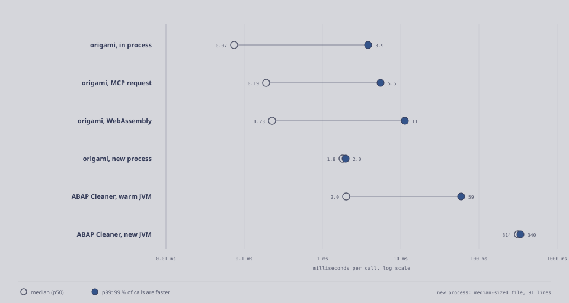
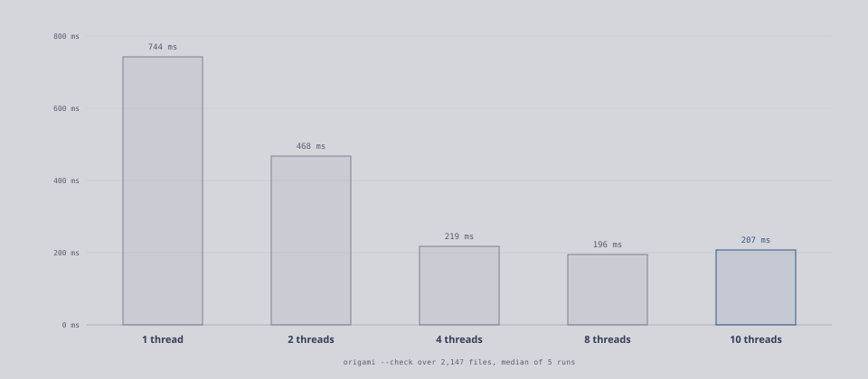

# Performance

<!-- Generated by `cargo xtask bench-matrix` from docs/benchmark-data.json; do not edit by hand. -->

Measured on 2026-11-22 on Apple M4 (10 cores, 16 GB), origami at commit `6eb564d`, on the test corpus: 2147 files (1920 ABAP), 476277 lines. All times in milliseconds. p95 and p99 are the latencies that 95 % and 99 % of the calls stay under; max is the slowest call.

<picture>
  <source media="(prefers-color-scheme: dark)" srcset="assets/latency-dark.svg">
  
</picture>

## One file

How long one call takes, depending on how origami is used.

| Use | p50 | p95 | p99 | max |
|---|---:|---:|---:|---:|
| In process, `format` (editor server, library) | 0.07 | 1.11 | 3.85 | 22.6 |
| In process, `explain` (the work behind `--review`) | 0.14 | 2.23 | 7.40 | 38.9 |
| MCP server, one `format` request (AI agent) | 0.19 | 1.80 | 5.48 | 30.9 |
| WebAssembly in Node (website playground) | 0.23 | 3.16 | 11.3 | 43.9 |
| New process per file, median-sized ABAP file (91 lines) | 1.81 | 1.99 | 1.99 | 1.99 |
| New process per file, 95th-percentile-sized ABAP file (897 lines) | 3.37 | 3.52 | 3.59 | 3.59 |
| New process per file, largest ABAP file (6837 lines) | 30.4 | 34.1 | 36.7 | 36.7 |
| ABAP Cleaner, per file, warm JVM (default profile) | 2.01 | 21.7 | 58.9 | 213 |
| ABAP Cleaner, new JVM per file (median-sized file) | 314 | 340 | 340 | 340 |

In process, origami needs 1.12 µs per line at the median (p99 3.18 µs). Per-file rows cover every corpus file (in process) or every fourth file (MCP, WebAssembly); the new-process rows are 30 runs each after 2 warm-up runs.

## Whole corpus

One command over the whole corpus, as in CI or a pre-commit run over a repository: median of 5 runs after one warm-up run.

<picture>
  <source media="(prefers-color-scheme: dark)" srcset="assets/threads-dark.svg">
  
</picture>

| Threads | p50 | max |
|---:|---:|---:|
| 1 | 744 | 779 |
| 2 | 468 | 495 |
| 4 | 219 | 242 |
| 8 | 196 | 221 |
| 10 | 207 | 218 |

Beyond four threads the gain is small on this machine: the Apple M4 has four performance cores and six efficiency cores. By default origami uses one thread per core.

| Output (all threads) | p50 | max |
|---|---:|---:|
| `--check`, human output | 172 | 180 |
| `--check --diagnostics agent` | 177 | 181 |
| `--check --diagnostics json` | 230 | 235 |
| `--review` (notes on every changed file) | 400 | 401 |

Peak memory of a whole-corpus run with 10 threads: 57 MB.

## ABAP Cleaner

ABAP Cleaner 1.29.2 with its default profile processes the ABAP files of the corpus in 11412 ms (sum of the per-file times, warm JVM, one thread). It applies about 100 cleanup rules, several of which change code; origami only changes layout, so the numbers compare the time to process the same files, not the same work. How it was run: [benchmark-abap-cleaner.md](benchmark-abap-cleaner.md).

## Reproduce

```sh
cargo xtask corpus fetch
cargo build --release -p abap-origami
cargo build --release -p origami_wasm --target wasm32-unknown-unknown   # optional
ABAP_CLEANER_PLUGINS=…/abapcleaner.app/Contents/Eclipse/plugins \
  cargo xtask bench-matrix                                            # ABAP Cleaner optional
python3 docs/diagrams/build.py                                        # charts
```
