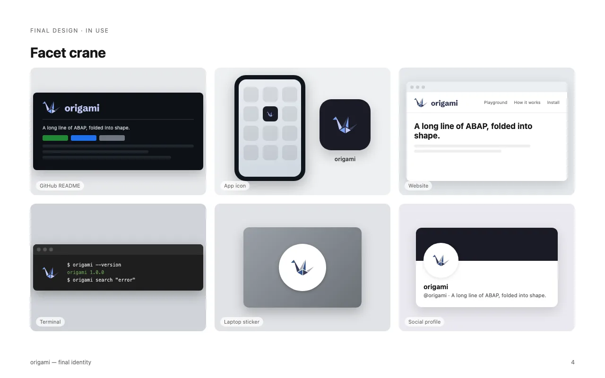

# origami: visual design

The visual language for the website, the README, the diagrams and the VS Code
extension. The website speaks the language of current developer product
sites: a dark ground, light used as a material, glass windows and tiles, one
typeface for words and one for code. Everything still serves one idea:

> **Every line break is a fold.** origami takes a long line of ABAP and folds
> it into shape, and it can say why it folded where it did.

The colors come from the [Tokyo Night](https://github.com/tokyo-night/tokyo-night-vscode-theme)
theme for VS Code. Many ABAP developers already read code in these colors, so
the page, the diagrams and the terminal look like their editor. Blue marks what
origami adds (a new line, a matched token, the margin); red marks what goes
wrong or away (a token that differs, a removed line).

## Audience and job

* **Who:** ABAP developers and SAP teams; many work in ADT for Eclipse or
  VS Code, review in abapGit, and are wary of tools that touch their code.
* **What the page has to do:** show in five seconds what origami does to real
  ABAP, prove that it never changes the meaning of the code, and get it
  installed (`brew install`, VS Code, CI).

## Color

The website is dark only (`color-scheme: dark`); there is no light theme. The
README and its diagrams keep their light and dark files.

| Token | Value | Use |
|---|---|---|
| `--bg` | `#0D0E14` | the ground |
| `--bg-deep` | `#08090E` | the footer, the closing spotlight's ground |
| `--surface`, `--surface-2` | `#16161E`, `#1A1B26` | windows, tiles, title bars |
| `--code-bg` | `#12131B` | code blocks inside tiles |
| `--head` | `#FFFFFF` | headlines |
| `--text` | `#C0CAF5` | text, code |
| `--text-2` | `#A9B1D6` | secondary text, the second tone of a heading |
| `--text-3` | `#8B92B8` | labels that repeat something said elsewhere, comments |
| `--line-no` | `#7C84AC` | line numbers |
| `--blue` | `#7AA2F7` | added lines, matched tokens, the margin, focus, the primary glow |
| `--violet` | `#BB9AF7` | keywords; keyword case in the layout marks |
| `--cyan` | `#7DCFFF` | rule IDs and notes, spaces in the layout marks, the live measurement |
| `--green` | `#9ECE6A` | strings; "formatted" status |
| `--orange` | `#FF9E64` | numbers |
| `--red` | `#F7768E` | a token that differs, removed lines, errors |
| `--yellow` | `#E0AF68` | the middle window dot; "kept as written" (W001) |
| `--line`, `--line-2`, `--line-3` | `rgba(192,202,245, .10 / .16 / .24)` | hairlines: dividers, window and tile edges, hover |
| `--button` | `#E6E9F7` | the light primary button |

Contrast on `--bg` (on `--surface-2` in brackets): white 19.3 (17.1),
`--text` 11.9 (10.6), `--text-2` 9.1 (8.1), `--text-3` 6.3 (5.6),
`--line-no` 5.3 (4.7), `--blue` 7.7 (6.8), `--red` 7.3 (6.5); every syntax
color is above 7:1. The primary button's text on `--button` is 15.9:1.

Rules:

* Accents carry meaning; they never fill large areas and are never a rainbow.
  Glows are the accent at low opacity, under or around an object.
* Syntax colors appear only in code. Keywords are colored, not bold.
* No light is ever drawn on body text.

## Type

Two families, both variable, self-hosted as Latin WOFF2 (SIL OFL 1.1, see
`THIRD_PARTY_NOTICES.md`) and preloaded:

* **Inter** (weight 400–700) for everything that is read: headlines, text,
  labels, buttons. Large sizes are tracked tight: the hero −0.045em, section
  headings −0.035em, tile headings −0.02em. The hero headline runs a vertical
  gradient from white to `#A9B1D6`.
* **Geist Mono** (weight 400–600) for code, commands, the terminal, rule IDs
  and the numbers in the speed table. Ligatures are off
  (`font-variant-ligatures: none; font-feature-settings: "liga" 0, "calt" 0`),
  so `=>` and `->` stay two characters, as ABAP has them.

Scale (px): 12 · 13 · 14 · 15 · 17 (body) · 19 (lead) · 20 (tile heading) ·
30–44 (section heading) · 44–76 (hero). Code is 12.5px (11.5px on phones),
so the sample's 72 columns fit the hero's right pane. Section headings are
two-tone: the first sentence white, the rest `--text-2`. Sentence case
everywhere; numbers that change use tabular figures.

## Light

Light is a material, used sparingly and large:

* **The cone:** a conic gradient from the top centre of the hero (blue,
  violet, cyan at under 50% opacity), blurred once by 46px. It breathes in on
  load and then drifts in opacity only (18s, alternating), and pauses when
  the hero is off screen.
* **The grid:** 72px squares of `rgba(192,202,245,.045)` lines, masked to
  fade out from the top centre.
* **Glows:** under the hero window (a radial pool), around the primary
  button, the window's outer shadow, the margin's tab, the speed bars, the
  active tab underline, a node in the pipeline.
* **The spotlight:** in the closing section a beam from above, a pool on the
  floor and a horizon line; the crane stands in it.

Only `opacity` and `transform` are animated; `filter` never is. The blurred
layers are static.

## Layout

* **Width:** at most 75rem; side margins `clamp(16px, 4vw, 32px)`.
* **Space:** steps of 4px (4, 8, 12, 16, 24, 32, 48, 64, 96, 140). Sections
  are 140px apart (96px on phones).
* **Bento:** a 12-column grid of tiles with 16px gaps (spans 4, 5, 7, 8, 12);
  one column below 56rem.
* **Order:** nav; hero; "Works where you work" chips; three chapters (Layout
  only, Checked every time, Explained); playground; speed; install; closing
  spotlight; footer.

```
1440                                          390
+--------------------------------------+     +----------------------+
| origami   How it works ...  [Install]|     | origami        Menu  |
+--------------------------------------+     +----------------------+
|          ( 0.4.3  badge )            |     |   ( 0.4.3 badge )    |
|        Format ABAP.                  |     |   Format ABAP.       |
|        Change nothing else.          |     |   Change nothing     |
|        sub-line                      |     |   else.              |
|   [Install origami] [Try it]         |     |   [Install] [Try]    |
|  +--------------------------------+  |     | +------------------+ |
|  | o o o  file.abap  origami.toml |  |     | | As written       | |
|  | As written | Folded   |72      |  |     | +------------------+ |
|  |            |          |        |  |     | | Folded       |40 | |
|  +-- tilted 14deg, fades out -----+  |     | +------------------+ |
|  chips: VS Code  ADT  abapGit ...    |     | chips (wrap)         |
| Layout only. ...                     |     | heading              |
| [ before/after marks  ][ never   ]   |     | [tile]               |
| Checked every time. ...              |     | [tile]               |
| [ cursor + tamper     ][ 20 of 20]   |     | ...                  |
| [ pipeline                       ]   |     |                      |
| Explained. ...                       |     |                      |
| [ terminal --review   ][ rules   ]   |     |                      |
| Playground window (full width)       |     | tabs: code/formatted |
| Speed: 4 numbers, bars tile          |     | 2 x 2 numbers        |
| Install tabs        | usage          |     | stacked              |
| Every line break is a fold.  [crane] |     | [crane]  copy        |
| footer columns                       |     | footer               |
+--------------------------------------+     +----------------------+
```

## Components

* **Nav:** sticky; transparent at the top, glass (`rgba(13,14,20,.72)`,
  16px backdrop blur) with a hairline once the page scrolls. Logo, links, a
  light "Install" button. Below 56rem a "Menu" button opens a sheet; Escape,
  a click outside or leaving it with Tab closes it.
* **Badge:** a pill above the headline with the version in a blue tag. The
  version is read by script from the release-please-marked Actions line in
  the install section, so it has one source; without scripting the tag stays
  hidden.
* **Buttons:** 46px high, 10px corners. Primary: `--button` with a blue glow;
  glass: a translucent fill with a hairline. Both press to 0.96.
* **Windows:** 14px corners, a title bar with three dots (red, yellow,
  green), a title or tabs in Geist Mono, a hairline, a deep shadow. The hero
  window, the self-check, the terminal and the playground are windows.
* **Tiles:** 20px corners, a dark vertical gradient, a 1px edge and a 1px
  inner highlight at the top. A soft blue light follows the pointer over a
  tile (fine pointers only).
* **Chips:** pills with a hairline; text only, no logos of other products.
* **Code blocks:** `--code-bg`, 12px corners, a hairline, a copy button.

## Logo

A paper crane as a low-poly model: seven flat facets, each one a fold. Every
edge runs at a multiple of 15°, so the crane looks constructed, not drawn. The
facets take three roles: `--ink`, `--valley` and `--crease`, each in its
theme's value. Between the facets runs a gap (the folds): 5 units on the
256-unit canvas in the light files, 6 units in the dark and white files,
because light shapes on a dark ground look larger and would close the gaps.
The head joins the neck without a gap. The outline has no stroke. Wordmark:
"origami" in Schibsted Grotesk 800, lower case, tracking −0.02em, set as paths
(SIL Open Font License, which allows logo use).

### Files

All in `docs/assets/`. Light files go on light grounds, `-dark` files on dark
grounds.

| File | Use |
| --- | --- |
| `logo.svg`, `logo-dark.svg` | the mark, 48px and up |
| `logo-small.svg`, `logo-small-dark.svg` | 32px and below: no gaps, larger in the canvas (site header) |
| `logo-lockup.svg`, `logo-lockup-dark.svg` | mark and wordmark side by side (README header) |
| `logo-lockup-stacked.svg`, `logo-lockup-stacked-dark.svg` | mark over the wordmark, for square spaces |
| `logo-wordmark.svg`, `logo-wordmark-dark.svg` | the wordmark alone, where the mark is already on screen |
| `logo-mono.svg`, `logo-white.svg` | one color: `--ink` (light) and white, e.g. on `--valley` |
| `logo-tile.svg` | the dark mark on a `--sheet` (dark) tile, filling 85% of its width: VS Code Marketplace icon, app icon |
| `favicon.svg` | the small cut; switches to the dark tones with the browser |

The PNG icons (`editors/vscode/icon.png` at 256px,
`docs/assets/apple-touch-icon.png` at 180px, without rounded corners because
iOS rounds them) are rendered from the tile. The social preview
(`docs/assets/social-preview.png`, from `site/og/og.html`) uses the dark theme.

### Colors

| Facet | Light (Tokyo Night Light) | Dark (Tokyo Night) |
| --- | --- | --- |
| neck, body right | `#343B58` · RGB 52 59 88 | `#C0CAF5` · RGB 192 202 245 |
| head, body left, wing back | `#34548A` · RGB 52 84 138 | `#7AA2F7` · RGB 122 162 247 |
| wing front, tail | `#A8AAB6` · RGB 168 170 182 | `#3B4261` · RGB 59 66 97 |
| tile | – | `#1A1B26` |

The logo is made for screens. For print, use `logo-mono.svg` and a CMYK
proof; a straight conversion of `#343B58` is C41 M33 Y0 K65.

### Rules

* **Clear space:** keep a quarter of the mark's height free on every side
  (for lockups: a quarter of the lockup's height).
* **Minimum size:** `logo.svg` 48px wide; `logo-small.svg` 16px; horizontal
  lockup 24px high.
* **Lockup spacing:** the gap between mark and wordmark is a third of the
  lockup's height; do not set the wordmark in live text next to the mark.
* **Backgrounds:** light files on `--paper`, `--sheet` or white; dark files on
  `--paper`/`--sheet` dark or GitHub's dark background; `logo-white.svg` on
  `--valley` or photos. The light files on `--valley` lose their blue facets.
* **Don't:** recolor single facets, add outlines, shadows or gradients, rotate
  or mirror the crane, close the gaps in the large files, or put the dark
  files on a light ground (the `--crease` facets disappear).

### In use



## Imagery

No photographs on the website. The 3D crane is the only image beyond the
logo.

| File (`docs/assets/`) | Use |
| --- | --- |
| `social-preview.png` | the link preview, 1280×640, rendered from `site/og/og.html` with a headless browser: the hero's ground, cone, grid and headline |
| `paper-fibre.webp` | 512px greyscale paper grain, the 3D crane's bump map and a faint grain in its colors |
| `photos/*.webp` | earlier photographs of a paper crane; no longer on the website |

The grain and the earlier photographs were generated with Nano Banana Pro
(Gemini 3 Pro Image). Keep source files out of the repository; commit WebP
under 80 KB each.

## 3D crane

The closing section draws the logo as a crane of real paper in WebGL
(`site/crane.js`, three.js r170 in `site/vendor/`). It is the only WebGL on
the page.

* **Geometry:** the seven facets of `logo.svg`, each a thin, rigid sheet with
  the logo's gaps between them. Every facet hangs from a neighbour and turns
  about the edge they share. Facets never bend.
* **Fold:** one number from 0 to 1. At 0 it is a flat sheet on the floor, the
  facets in the paper's tone with dashed blue creases at the hinges; at 1 the
  crane stands. It folds up once (1.9s) when half of it is in view.
* **Spotlight:** matte paper in `--text`, `--blue` and slate `#3B4261`; a key
  light from the upper left, a light close to the crane, a sky light and one
  soft shadow. A mirrored copy of the facets at 16% opacity is its reflection
  on the floor, faded out by a mask on the canvas.
* **Pointer:** it turns a little toward the mouse; a sideways drag turns it
  within limits and eases back.
* **Limits:** loaded when the closing section is 600px away; drawn only while
  something moves (no idle frames), while on screen and the tab is visible;
  at most 2 device pixels per CSS pixel; `aria-hidden`. Without WebGL 2, with
  Save-Data, on devices that report less than 2 GB of memory, or when the
  module fails to load, `logo-dark.svg` stands in the same light with a
  faint mirrored reflection. Without scripting, the same.

## Motion

* **Easing:** `cubic-bezier(0.2, 0, 0, 1)` for everything.
* **Hero, once on load (CSS):** badge, the two headline lines, the sub-line
  and the buttons rise 14px and fade in, 600ms each, 70–80ms apart; the
  window rises 60px into its tilt (900ms, from 380ms); the cone breathes in
  (1.6s).
* **Scroll:** the hero window lies down from 14° to flat and its bottom fade
  opens as it rises through the screen (one update per frame, no change to
  native scrolling, no pinning).
* **Entrances:** headings and tiles rise 22px and fade in once, 560ms,
  siblings 70ms apart, as they come into view.
* **In the chapters:** the self-check's cursor walks the 20 tokens (70ms a
  token) once when the tile is half in view; the terminal types the command
  and then shows the output line by line, once.
* **Loops:** only the cone's opacity drift; it pauses off screen.
* **Feedback:** hover and press on every control, 150–250ms.
* **Reduced motion:** no entrances, no tilt, no drift, no typing, no walk:
  everything is shown in its final state. **Without scripting:** the same,
  with the formatted views written into the page at build time.

## Voice

Plain, specific, calm. Say what origami does to the code ("puts each
parameter on its own line when the call is too long"), not how good it is.
Numbers are measured and linked to their source; the page shows the
published ones and measures nothing it does not say it measured. No
exclamation marks.

## Where it applies

* **Website (`site/`):** `index.html` and `abap-cleaner.html` (generated by
  `scripts/abap-cleaner-compare/build.py`), sharing the header, the footer,
  `style.css` and `nav.js`.
* **Formatted code on the website:** every formatted line comes from
  origami. The samples live in one place, `site/samples/` (the hero's class,
  its `origami.toml`, the captured `origami --review` output) and
  `site/samples.js` (the single statements of the chapters). `site/build.sh`
  runs `site/fill.mjs`, which formats them with the freshly built
  `origami.wasm` and writes the views the page shows without scripting; with
  scripting the page computes the same views live. After a formatter change,
  run `site/samples/review.sh` for the terminal and rebuild.
* **README:** logo, one sentence, badges, the animated terminal (light and
  dark), diagrams in light and dark SVG.
* **Diagrams:** the benchmark charts and `pipeline*.svg` in the Tokyo Night
  palette (light and dark SVG).
